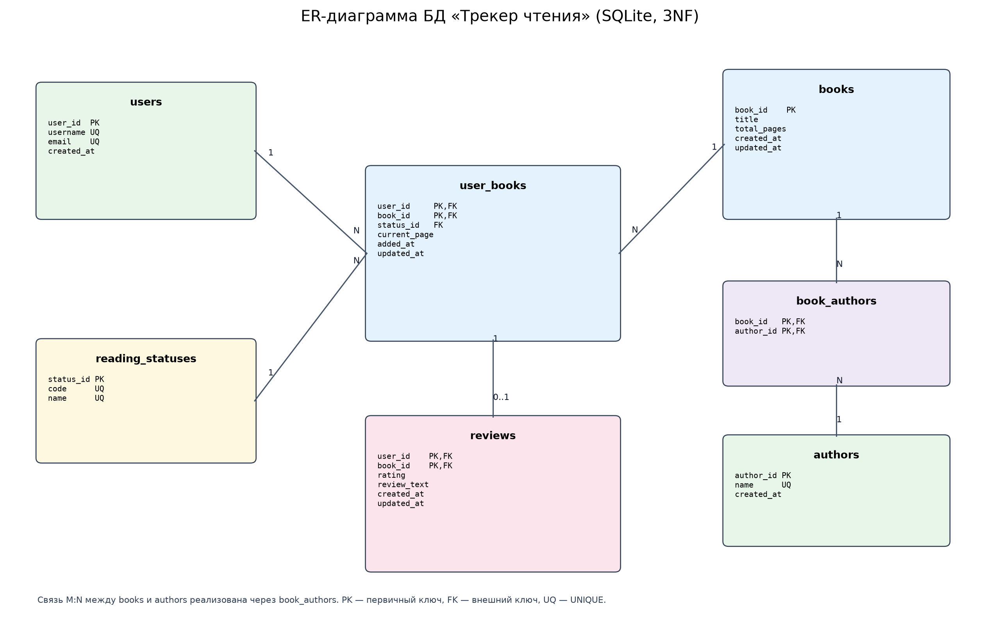
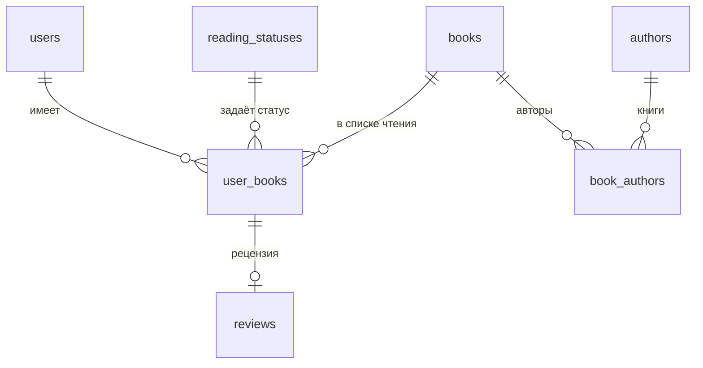

# Процесс проектирования и нормализации базы данных «Трекера чтения»

Лабораторная работа №4. СУБД: **SQLite**. Схема приведена к **третьей нормальной форме (3NF)**.

## 1. Исходная (денормализованная) структура

Для демонстрации процесса нормализации представим, что все данные хранятся в одной плоской таблице:

`Reading_Flat(entry_id, username, email, book_title, author_names, total_pages, status_name, current_page, review_text, rating)`

Пример строки:

| entry_id | username | email | book_title | author_names | total_pages | status_name | current_page | review_text | rating |
|---|---|---|---|---|---|---|---|---|---|
| 1 | alex_reader | alex@example.com | 1984 | Джордж Оруэлл | 328 | Читаю | 120 | NULL | NULL |
| 2 | alex_reader | alex@example.com | Мастер и Маргарита | Михаил Булгаков | 480 | Прочитано | 480 | Отличный роман… | 5 |

**Проблемы исходной структуры:**

- **Избыточность:** `username` и `email` повторяются для каждой книги пользователя; `author_names` и `total_pages` повторяются для каждой записи о книге.
- **Аномалия обновления:** при смене email пользователя пришлось бы обновлять все его записи; при изменении числа страниц книги — все записи с этой книгой.
- **Аномалия удаления:** удаление последней книги пользователя может привести к потере сведений о самом пользователе.
- **Аномалия вставки:** нельзя добавить автора или книгу, пока они не привязаны к записи списка чтения.

## 2. Нормализация до 1NF (первая нормальная форма)

**Цель:** все атрибуты атомарны, нет повторяющихся групп и списков в одной ячейке.

- **Что было не так:** поле `author_names` могло содержать список авторов через запятую (например, «Аркадий Стругацкий, Борис Стругацкий»), что нарушает атомарность.
- **Наши действия:** вынесли авторов в отдельную таблицу `authors`, а связь книг и авторов оформили через промежуточную таблицу `book_authors`. Статус чтения вынесен в справочник `reading_statuses`.
- **Результат:** каждая ячейка хранит одно значение; списки авторов и статусов больше не хранятся в одной колонке.

## 3. Нормализация до 2NF (вторая нормальная форма)

**Цель:** выполнена 1NF, и каждый неключевой атрибут полностью зависит от всего первичного ключа (устранены частичные зависимости).

- **Что было не так:** в записи списка чтения составной ключ `(user_id, book_id)`. Поля `username`, `email` зависят только от `user_id`, а `book_title`, `total_pages` — только от `book_id`. Это частичные зависимости.
- **Наши действия:** создали отдельные таблицы `users` и `books`. В таблице `user_books` оставили только атрибуты, зависящие от всей пары `(user_id, book_id)`: `status_id`, `current_page`, `added_at`, `updated_at`.
- **Результат:** в `user_books` нет полей, зависящих лишь от части составного ключа. Аналогично в `reviews` с ключом `(user_id, book_id)` оставлены только `rating`, `review_text` и временные метки.

## 4. Нормализация до 3NF (третья нормальная форма)

**Цель:** выполнена 2NF, и нет транзитивных зависимостей (неключевой атрибут не зависит от другого неключевого атрибута).

- **Что было не так:** если бы в `user_books` оставалось поле `status_name`, оно зависело бы от `status_id`, а не напрямую от ключа записи. Если бы в `books` оставалось поле `author_name`, оно зависело бы от автора, а не от книги.
- **Наши действия:** вынесли названия статусов в `reading_statuses`, имена авторов — в `authors`. В рабочих таблицах остались только внешние ключи `status_id`, `author_id` и т.п.
- **Результат:** все неключевые атрибуты зависят только от первичного ключа своей таблицы. Схема находится в 3NF.

## 5. Реализация связей «многие-ко-многим» (M:N)

- **Книги ↔ Авторы:** одна книга может иметь нескольких авторов, один автор может написать несколько книг. Связь реализована через таблицу `book_authors(book_id, author_id)` с составным первичным ключом.
- **Пользователи ↔ Книги:** пользователь может иметь много книг в списке, книга может быть в списках многих пользователей. Связь реализована через `user_books(user_id, book_id)`; эта же таблица хранит атрибуты связи: статус и прогресс.
- **Рецензия:** одна рецензия на пару `(user_id, book_id)` обеспечивается составным первичным ключом таблицы `reviews`.

## 6. Финальная схема



Исходники диаграммы: [SVG](../docs/database/er_diagram.svg), [PNG](../docs/database/er_diagram.png).



### Таблицы

| Таблица | Первичный ключ | Внешние ключи | Назначение |
|---|---|---|---|
| `users` | `user_id` | — | Пользователи |
| `authors` | `author_id` | — | Авторы |
| `reading_statuses` | `status_id` | — | Справочник статусов чтения |
| `books` | `book_id` | — | Каталог книг |
| `book_authors` | `(book_id, author_id)` | `book_id`, `author_id` | Связь M:N книги ↔ авторы |
| `user_books` | `(user_id, book_id)` | `user_id`, `book_id`, `status_id` | Список чтения и прогресс |
| `reviews` | `(user_id, book_id)` | `(user_id, book_id)` → `user_books` | Рецензии и оценки |

## 7. Ограничения целостности и индексы

### Ограничения

- `UNIQUE`: `users.username`, `users.email`, `authors.name`, `reading_statuses.code`, `reading_statuses.name`.
- `CHECK`: `total_pages > 0`, `current_page >= 0`, `rating BETWEEN 1 AND 5`, непустые `title`, `username`, `name`, `review_text`.
- Триггеры запрещают `current_page > total_pages` и уменьшение `total_pages` ниже уже зафиксированного прогресса.
- Внешние ключи с `ON DELETE CASCADE` удаляют зависимые записи списка чтения, рецензии и связи авторов; справочник статусов защищён `ON DELETE RESTRICT`.

### Индексы

| Индекс | Назначение |
|---|---|
| `idx_user_books_user_id` | Быстрая выборка списка чтения пользователя |
| `idx_user_books_book_id` | Поиск пользователей, читающих книгу |
| `idx_user_books_status_id` | Фильтрация по статусу |
| `idx_books_title` | Поиск и сортировка по названию |
| `idx_authors_name` | Поиск по автору |
| `idx_book_authors_author` | Выборка книг автора |
| `idx_reviews_book_id` | Выборка рецензий на книгу |

## 8. Запуск скриптов

```bash
sqlite3 reading_tracker.db < database/schema.sql
sqlite3 reading_tracker.db < database/seed_data.sql
```

Также скрипты можно выполнить в онлайн-редакторе SQLite, например sqliteonline.com.
